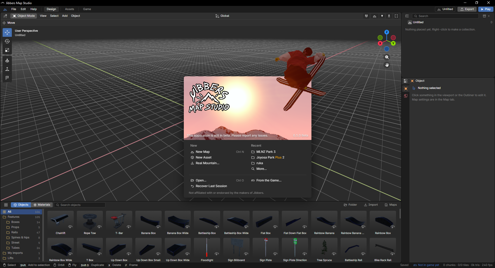

Jibbers Map Studio
==================

Jibbers Map Studio is a free and open source 3D suite for Jibbers designed to support map creation from start to finish.

Download
--------

- [Latest release](https://github.com/chrisrca/jibbers-map-studio/releases/latest)

Development
-----------

- `npm install`, then `npx tauri dev` to run it
- `npm test` and `npm run lint` to check it

Third-party code and its licences: [THIRD_PARTY.md](THIRD_PARTY.md).
